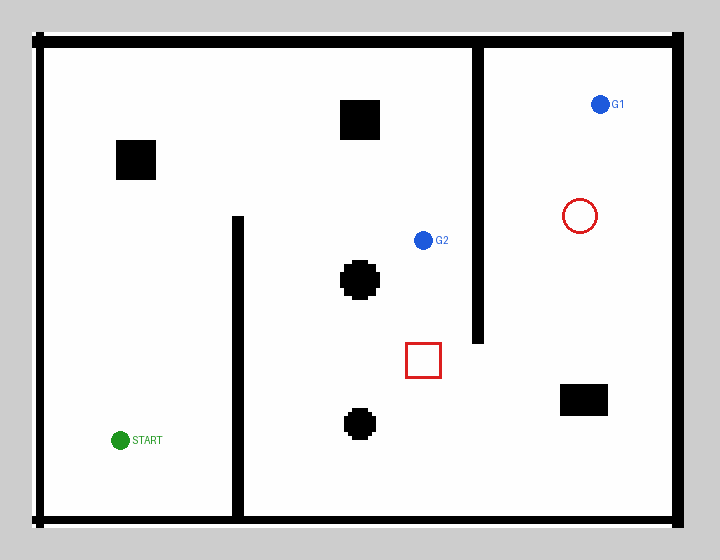

# TurtleBot3 + Nav2 Autonomous Navigation in Gazebo

A TurtleBot3 Burger navigating autonomously through a custom obstacle course using the ROS 2 Navigation2 (Nav2) stack, including obstacles that are **not on the map** and must be detected live with the lidar.

> **Demo video:** _[add your YouTube / Google Drive link here]_



*Occupancy map of the course. Green = spawn, blue = patrol goals, red outlines = "surprise" obstacles spawned at runtime that are absent from the map.*

## What this demonstrates

- **Global planning:** two divider walls force an S-shaped route, so the robot can't drive straight to its goal.
- **Localization:** AMCL localizes against a pre-built map and starts at the correct pose automatically.
- **Dynamic obstacle avoidance:** obstacles can be dropped onto the robot's path mid-run. Nav2 sees them only through the lidar and replans around them.
- **Scripted missions:** a multi-goal patrol driven by the Nav2 Simple Commander API, alongside manual goals from RViz.

## Environment

| Component | Version |
| --- | --- |
| OS | Ubuntu 22.04 |
| ROS 2 | Humble |
| Simulator | Gazebo Classic 11 |
| Robot | TurtleBot3 Burger |
| Navigation | Nav2 (AMCL + NavFn planner + DWB controller) |

## Setup

Prerequisite: [ROS 2 Humble Desktop](https://docs.ros.org/en/humble/Installation/Ubuntu-Install-Debs.html) on Ubuntu 22.04.

```bash
mkdir -p ~/tb3_ws/src && cd ~/tb3_ws/src
git clone https://github.com/<your-username>/tb3-nav2-gazebo-demo.git
cd tb3-nav2-gazebo-demo
./setup.sh          # installs Nav2, TurtleBot3, Gazebo packages and builds the workspace
```

<details>
<summary>Manual install instead of setup.sh</summary>

```bash
sudo apt install ros-humble-gazebo-ros-pkgs ros-humble-navigation2 ros-humble-nav2-bringup \
  ros-humble-nav2-simple-commander ros-humble-turtlebot3 ros-humble-turtlebot3-gazebo \
  ros-humble-slam-toolbox python3-colcon-common-extensions
cd ~/tb3_ws && source /opt/ros/humble/setup.bash
colcon build --symlink-install
```
</details>

## Running the demo

Source the workspace in every terminal:

```bash
source /opt/ros/humble/setup.bash && source ~/tb3_ws/install/setup.bash
```

**Terminal 1: launch everything** (Gazebo, robot, Nav2, RViz):

```bash
ros2 launch tb3_nav2_demo demo.launch.py
```

Wait about 10 seconds until RViz shows the map, the costmaps, and the robot with its AMCL particle cloud. No manual pose estimate is needed.

**Option A: send a goal manually.** Click **Nav2 Goal** in the RViz toolbar, then click and drag on the map to set position and heading.

**Option B: run the scripted patrol** (Terminal 2):

```bash
ros2 run tb3_nav2_demo send_goals          # once
ros2 run tb3_nav2_demo send_goals --loop   # repeat
```

**Add surprise obstacles** (Terminal 3, while the robot is still in the west room heading to G1):

```bash
ros2 launch tb3_nav2_demo surprise_obstacles.launch.py
```

Two red obstacles appear on the planned route. Watch them appear in the costmaps in RViz and the green path reroute around them.

### Launch arguments

| Argument | Default | Purpose |
| --- | --- | --- |
| `headless` | `false` | Run Gazebo without its GUI (saves CPU) |
| `use_rviz` | `true` | Start RViz |
| `slam` | `false` | Build a map with SLAM Toolbox instead of localizing with AMCL |
| `map` | bundled map | Use a different map yaml |
| `params_file` | stock + overrides | Supply a complete Nav2 params file |

## How it works

```
Gazebo (obstacle_course.world)
  └── TurtleBot3 Burger ── /scan (LDS lidar), /odom, TF ──┐
                                                          ▼
Nav2:  map_server ─► AMCL (localization) ─► global costmap ─► NavFn (global path)
                                            local costmap  ─► DWB (velocity commands) ─► /cmd_vel
                     BT Navigator orchestrates planning, control and recovery behaviours
```

**World and map from one source.** `tools/generate_world_and_map.py` defines the layout once as a list of boxes and cylinders, then writes both the Gazebo `.world` file and the Nav2 `.pgm/.yaml` occupancy map. The map therefore matches the simulation exactly, with no SLAM artefacts, which makes localization reliable. To change the course, edit the layout in that script and re-run it.

**Parameters as a minimal diff.** Rather than copying Nav2's ~350-line params file, the launch file loads the stock `nav2_params.yaml` and deep-merges `config/nav2_overrides.yaml` on top. Every value in the overrides file is a deliberate change, which keeps the tuning easy to review.

## Tuning decisions

The stock Nav2 parameters target the larger TurtleBot3 Waffle. I adapted them for the Burger:

| Parameter | Default | Mine | Why |
| --- | --- | --- | --- |
| `robot_radius` | 0.22 m | 0.12 m | Burger radius is 0.105 m; the Waffle value overestimates the footprint and blocks narrow gaps |
| local `inflation_radius` | 0.55 m | 0.35 m | 0.55 m nearly closes the ~0.9 m gaps around the surprise obstacles |
| local `cost_scaling_factor` | 3.0 | 4.0 | Cost falls off faster, so the robot is less hesitant near walls |
| global `inflation_radius` | 0.55 m | 0.40 m | Slightly larger than local to keep global paths centred in corridors |
| `max_vel_x` | 0.26 m/s | 0.22 m/s | Burger's hardware speed limit |
| `xy_goal_tolerance` | 0.25 m | 0.15 m | Stops noticeably closer to the clicked goal |
| AMCL `set_initial_pose` | false | true | Localizes at spawn automatically; no manual pose estimate |

<!-- TODO: add what you observed while testing these values, e.g. before/after behaviour. -->

## Building your own map with SLAM (optional)

```bash
ros2 launch tb3_nav2_demo demo.launch.py slam:=true
# drive around with RViz goals or teleop:
ros2 run turtlebot3_teleop teleop_keyboard
# save the map when done:
ros2 run nav2_map_server map_saver_cli -f ~/my_map
# then navigate with it:
ros2 launch tb3_nav2_demo demo.launch.py map:=$HOME/my_map.yaml
```

## Repository structure

```
tb3-nav2-gazebo-demo/
├── setup.sh                         # dependency install + build
├── tools/generate_world_and_map.py  # writes world + matching map from one layout
├── docs/map_preview.png
└── tb3_nav2_demo/                   # ROS 2 package (ament_python)
    ├── launch/
    │   ├── demo.launch.py               # Gazebo + robot + Nav2 + RViz
    │   └── surprise_obstacles.launch.py # spawns unmapped obstacles at runtime
    ├── config/nav2_overrides.yaml   # Burger-specific Nav2 tuning
    ├── worlds/obstacle_course.world
    ├── maps/obstacle_course.{pgm,yaml}
    ├── models/surprise_*.sdf
    └── tb3_nav2_demo/send_goals.py  # Simple Commander patrol
```

## Troubleshooting

- **Gazebo window is black or the launch hangs:** a stale Gazebo process is probably still running. Run `killall -9 gzserver gzclient` and relaunch.
- **"Package 'tb3_nav2_demo' not found":** source `~/tb3_ws/install/setup.bash` in that terminal.
- **Robot doesn't appear in RViz / TF errors at start:** normal for the first few seconds while Nav2 starts (it is delayed 5 s on purpose). If it persists, check that `TURTLEBOT3_MODEL` isn't overridden elsewhere in your shell config.
- **Robot spins in place or "Failed to make progress":** usually a goal inside an inflated zone. Pick a goal further from walls, or lower `inflation_radius`.
- **Slow simulation (real-time factor well below 1.0):** use `headless:=true` and watch RViz only, or close other heavy apps.
- **Running in a VM or WSL2:** Gazebo needs 3D acceleration. If it crashes, try `export LIBGL_ALWAYS_SOFTWARE=1` (slower but stable).

## Possible next steps

- Compare the DWB controller against Regulated Pure Pursuit and MPPI on the same course.
- Add Nav2 keepout zones (costmap filters) to forbid an area of the map.
- Make the surprise obstacles move to test genuinely dynamic avoidance.
- Port to ROS 2 Jazzy and the modern Gazebo simulator.

## Acknowledgements

Built on [Nav2](https://docs.nav2.org/), [ROBOTIS TurtleBot3](https://emanual.robotis.com/docs/en/platform/turtlebot3/overview/), and Gazebo. AI tools were used to help scaffold code and documentation, as permitted by the assignment.
